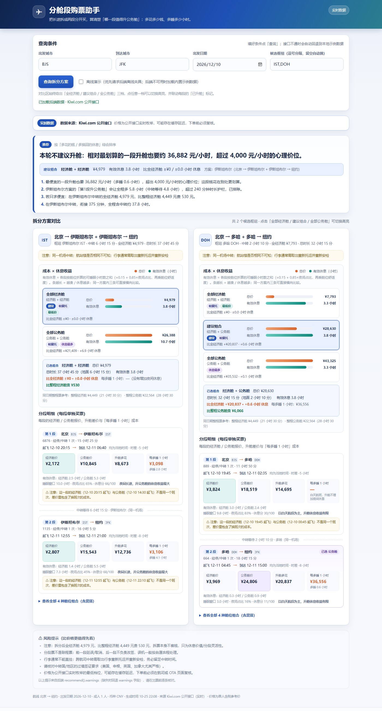
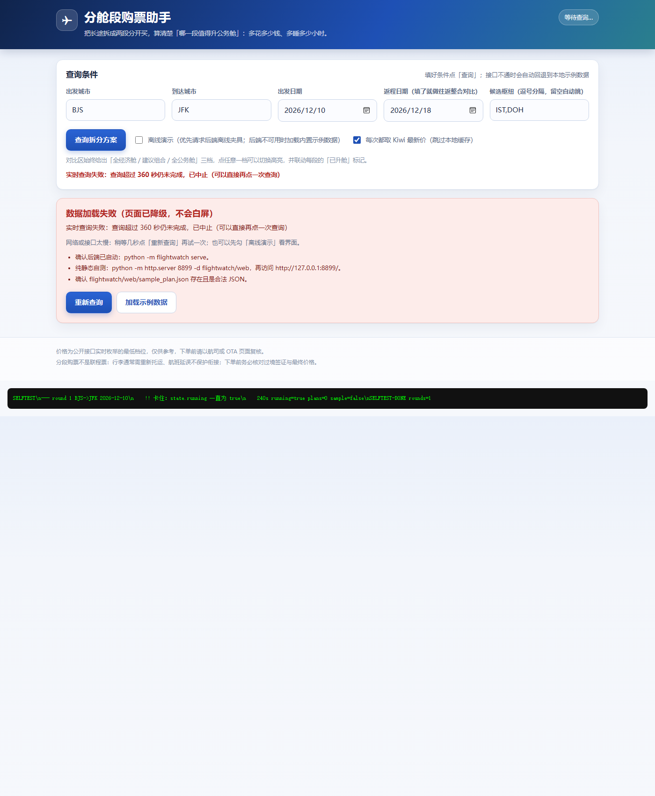
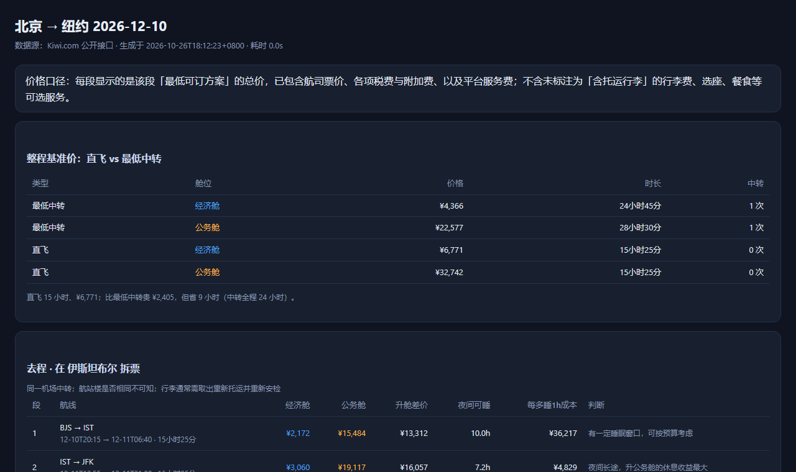
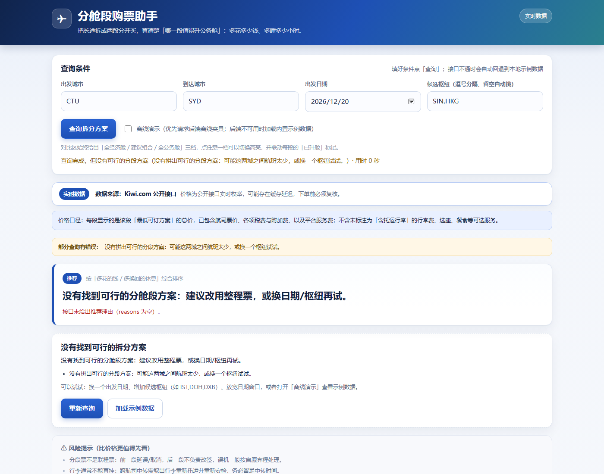

# flightwatch

**Split-ticket & cabin comparison for long-haul flights — find out which leg is actually worth
upgrading to business class, in cost per extra hour of sleep.**

[](https://www.python.org/)
[](https://github.com/chrischenj/flightwatch/actions/workflows/ci.yml)
[](LICENSE)
[](pyproject.toml)



### Download

| What you want | Where to get it |
|---|---|
| **Zip bundle** (no git needed) | [**Latest release**](https://github.com/chrischenj/flightwatch/releases/latest) → download `flightwatch-vX.Y.Z.zip` → unzip → double-click `start-windows.bat` (Windows) or run `python -m flightwatch serve` |
| **Source** | `git clone https://github.com/chrischenj/flightwatch.git` |
| **Requirements** | Python **3.9+**, **no third-party packages** (standard library only) |

The zip is a plain source bundle: keep the folder structure, then run from inside it.

## English Overview

**The problem.** Airlines and OTAs only sell you a direct flight or one connecting itinerary, and
the whole itinerary is locked to a single cabin class. On a long-haul trip that leaves two bad
options: fly the entire way in economy, or pay for business class on every segment.

**What this tool does.** It splits the journey at a hub into separately booked one-way tickets,
prices every segment in both cabins, and ranks upgrades by **cost per extra hour of sleep**
instead of by raw price difference.

### How the recommendation is made

1. **Split** — choose hubs where the detour ratio `(d(origin,hub) + d(hub,dest)) / d(origin,dest)`
   stays under `1.6`, so you never route absurdly far just to save money.
2. **Price** — cheapest economy and cheapest business for each segment; combine them into all
   four cabin mixes, plus the cheapest through fare as a baseline.
3. **Score** — `effective_rest = night_hours × (0.15 + 0.85 × night_ratio) × cabin_comfort`
   with `economy 0.35 / premium 0.60 / business 1.00 / first 1.15`, then
   `cost_per_rest_hour = upgrade_price_delta / rest_delta`.
4. **Guard** — an upgrade is only recommended if it adds **≤ 4 hours** of total travel time and
   costs **≤ ¥4,000 per extra hour of rest**. Otherwise the tool explicitly says *“don't upgrade
   this time”* — it is built to say no when the numbers are bad.

### Features

- **Split-ticket pricing** — 2 segments × 2 cabins → 4 mixed combos, compared against the cheapest
  single itinerary.
- **Nonstop baseline** — every query also prices the whole journey with `maxStopsCount=0`, so you
  can weigh “pay ¥X more, save Y hours” directly.
- **Round-trip integration** — one return ticket / two one-ways / split outbound only / split
  return only / split both / nonstop return, sorted by total price.
- **Live data, honest fallbacks** — prices and even city-name lookup come from Kiwi.com's public
  GraphQL endpoint in real time; a deterministic offline fixture keeps demos and tests network-free.
- **Four ways to use it** — local web UI, CLI, exportable HTML report, and a `watch` price monitor.
- **Zero dependencies** — Python standard library only (3.9+).

### Quick start

```bash
git clone https://github.com/chrischenj/flightwatch.git
cd flightwatch

python -m flightwatch serve                 # local web UI → http://127.0.0.1:8765/

python -m flightwatch plan \
  --from PEK --to JFK --date 2026-12-10 --hubs IST,DOH      # one-way
python -m flightwatch plan \
  --from PEK --to JFK --date 2026-12-10 --return 2026-12-18 # round trip
python -m flightwatch plan ... --offline                    # no network, synthetic data
```

Sample output (real query, one-way, economy vs business on each segment):

```
整程直搜最低：经济舱 ¥4,366 / 24小时45分 / 1次中转
整程直飞：    经济舱 ¥6,771 / 15小时25分 / 0次中转
  → 直飞 15 小时、¥6,771；比最低中转贵 ¥2,405，但省 9 小时（中转全程 24 小时）
```

```bash
python tests/test_engine.py      # 33 cases
python tests/test_api.py         # 20 cases
```

### Data source & disclaimer

Prices come from the public GraphQL endpoint used by the Kiwi.com web frontend
(`api.skypicker.com/umbrella/v2`). It is **not** an official open API: no stability guarantee, rate
limited, subject to Kiwi.com's terms. This project is **not affiliated with Kiwi.com** — use it at
low frequency for personal research only, and always re-check the final price before booking.
Full text: [DISCLAIMER.md](DISCLAIMER.md).

> The web UI, CLI output and the rest of this README are currently in Chinese.
> English localisation of the UI is a welcome pull request.

---

## 中文说明

### 下载

| 你想要 | 去哪里拿 |
|---|---|
| **压缩包**（不用装 git） | [**最新 Release**](https://github.com/chrischenj/flightwatch/releases/latest) → 下载 `flightwatch-vX.Y.Z.zip` → 解压 → Windows 双击 `start-windows.bat`，其他系统在该目录执行 `python -m flightwatch serve` |
| **源码** | `git clone https://github.com/chrischenj/flightwatch.git` |
| **环境要求** | Python **3.9+**，**零第三方依赖**（只用标准库） |

> 压缩包是源码包：解压后保持目录结构，在该目录里运行即可。需要先装好 Python，
> 安装时勾选「Add python.exe to PATH」。

纯 Python 标准库，**零第三方依赖**；自带本地网页界面、命令行、往返对比、HTML 报告和定时监控。

平台（携程/去哪儿/航司官网/Kiwi）只会给你两种答案：整程直飞或整程中转，且整程只有一个舱位。
这个工具绕过这个限制：它把整程**按枢纽切成若干段**，每段**单独查经济舱和公务舱的最低价**，
然后算清楚「升哪一段最划算」——代价是多花多少钱，收益是多睡多少小时。

---

## 特性一览

- **拆段比价**：以枢纽为切点拆成 2 段，每段独立查经济舱 / 公务舱最低价，组合出 4 种混搭
- **升舱性价比**：用「每多睡 1 小时的成本」排序，而不是只看差价
- **直飞基准线**：每次都单独查「整程不中转」的报价，和最低中转、拆段方案并排对比
- **往返整合**：一张往返票 / 两张单程 / 去回程分别拆段 / 直飞往返，按总价排序
- **两道防忽悠护栏**：升舱导致全程多 4 小时以上、或每多睡 1 小时超 ¥4000，结论直接说「不建议升舱」
- **实时数据**：价格全部来自 Kiwi.com 公开接口现场拉取，城市名也实时解析，不依赖内置名单
- **离线可跑**：内置合成数据源，没网也能演示、跑测试
- 三种用法：本地网页 / 命令行 / 导出可归档的 HTML 报告；另有 `watch` 定时复查价格

---

## 截图

**往返整合对比**（一张往返票 / 两张单程 / 直飞往返 / 去回程分别拆段）：



**导出的 HTML 报告**（含「直飞 vs 最低中转」基准表，可直接分享/归档）：



**没有可行方案时的空状态**（明确告诉你原因，不会拿示例数据冒充）：



---

## 一、它是怎么想的（方法论）

### 1. 拆：在枢纽把整程切开

以 北京 → 纽约 为例，工具会自动（或按你指定的枢纽）枚举：

```
方案 A：北京 → 伊斯坦布尔（第 1 段） + 伊斯坦布尔 → 纽约（第 2 段）
方案 B：北京 → 多哈（第 1 段）       + 多哈 → 纽约（第 2 段）
方案 C：北京 → 首尔（第 1 段）       + 首尔 → 纽约（第 2 段）
```

每段都是一张独立单程票，可以分开买、可以是不同航司、可以选不同舱位。
枢纽的筛选条件是**绕行比**（两段距离之和 ÷ 直线距离 ≤ 1.6），避免为了拆而绕远。

### 2. 比：每段都问两个价格

对每一段，工具分别去查：

| | 经济舱最低价 | 公务舱最低价（整段全公务舱） |
|---|---|---|
| 北京 → 伊斯坦布尔 | ¥2,172 | ¥10,845 |
| 伊斯坦布尔 → 纽约 | ¥2,654 | ¥10,362 |

于是同一个方案下自动生成 4 种混合组合：经济+经济、经济+公务、公务+经济、公务+公务。
总价 = 各段报价相加（这是"分开买"的真实成本结构）。

### 3. 选：用「每多睡 1 小时要多少钱」排序

升舱不是"贵不贵"的问题，而是"这一段升了到底能不能睡"的问题。所以工具对每一段算：

```
夜间可睡时长 sleep_h = 飞行窗口中落在 21:00–07:00（出发地当地时间）的部分
夜间占比 night_ratio = sleep_h ÷ 飞行小时数
有效休息 effective_rest_h = sleep_h × (0.15 + 0.85 × night_ratio) × 舱位舒适系数
       舱位舒适系数：经济舱 0.35 / 超经 0.60 / 公务舱 1.00 / 头等 1.15
升舱性价比 = 公务舱价 − 经济舱价
             ────────────────────────
             公务舱有效休息 − 经济舱有效休息
```

**"每多睡 1 小时的成本"越小，这一段越值得升舱。** 白天短途升舱会得到很差的分值，
跨夜长途升舱会得到很好的分值——这正是你想要的判断。

工具还给结论加了两道「别硬推」的护栏，避免它为了给你一个答案而瞎推荐：

- **时长护栏**：如果升舱会让全程多飞/多等 **4 小时以上**，这个组合不进入推荐
  （多睡的那点时间还不够抵消干等和折腾）。
- **价位护栏**：如果最划算的一段也要 **> 4000 元/小时**，或者升了只多睡 **不到 1 小时**，
  结论会直接写「**本轮不建议升舱**」，同时给出「如果一定要升，相对最划算的是哪段」作参考。

工具最后给出三种可视化对照：全经济舱 / 推荐组合（只升某一段）/ 全公务舱，
并明确写出「多花 ¥X，多睡 Y 小时，折合 ¥Z/小时」。

### 4. 先摆一条「直飞基准线」

拆段再划算，也得跟「直接坐直飞」比一比。所以每次查询都会额外单独查一次
**整程不中转**的报价（同一个 Kiwi 接口，只是把 `maxStopsCount` 设为 `0`），
和「最低中转价」并排摆出来，例如：

```
整程直搜最低：经济舱 ¥4,366 / 24小时45分 / 1次中转
整程直飞：    经济舱 ¥6,771 / 15小时25分 / 0次中转
  → 直飞 15 小时、¥6,771；比最低中转贵 ¥2,405，但省 9 小时（中转全程 24 小时）
```

这条线会进结论，也会进导出的报告。没有直飞航线的城市（比如上海→米兰）会明确显示「无直飞」，
不会假装有。往返模式下同理：除了「直飞往返票」，还会给「两张直飞单程票」。

---

## 二、怎么用

### 安装

```bash
git clone https://github.com/<your-name>/flightwatch.git
cd flightwatch
pip install -e .          # 可选：安装后可以直接用 flightwatch 命令
```

不需要安装任何第三方依赖（纯标准库）。不装也行，在仓库根目录直接用 `python -m flightwatch ...`。

### ① 网页版（推荐）

```bash
python -m flightwatch serve
# 或安装后：flightwatch serve
```

浏览器会自动打开 `http://127.0.0.1:8765/`。填出发城市、到达城市、日期即可。

- **Windows 用户**：也可以直接双击根目录的 `start-windows.bat`，它会探测端口、起服务并打开浏览器；
  关掉那个黑色窗口就停止服务。（脚本用 GBK 编码，为了在中文 Windows 控制台里正常显示中文。）
- 第一次运行建议先勾选「离线演示」把界面看熟（不联网、0.5 秒出结果）。
- 想对比往返：再填「返程日期」即可。
- 网页默认「每次都取 Kiwi 最新价」，会跳过本地缓存；取消勾选才走 30 分钟缓存加速。

### ② 命令行

```bash
# 实时查询（中文/英文/三字码都认）
python -m flightwatch plan --from 北京 --to 纽约 --date 2026-12-10 --hubs IST,DOH

# 不联网演示
python -m flightwatch plan --from 北京 --to 纽约 --date 2026-12-10 --offline

# 导出可归档/可分享的 HTML 报告
python -m flightwatch export --from 北京 --to 纽约 --date 2026-12-10 -o 报告.html
```

### ③ 定时监控（价格变了提醒你）

```bash
# 每 30 分钟复查一次，把快照存到 data/history/，有变化会打印出来
python -m flightwatch watch --from 北京 --to 纽约 --date 2026-12-10 --interval 30

# 只跑 6 轮，且全经济舱总价低于 4500 时提醒
python -m flightwatch watch --from 北京 --to 纽约 --date 2026-12-10 --rounds 6 --alert-below 4500
```

每轮都会写一份 `data/history/snap-*.json` 和一行 `index.jsonl`，
可以直接看出「哪一段的公务舱价格在往下走」。

### ④ 往返整合（填返程日期即可）

把 **返程日期** 也填上，工具就会自动对比几种**往返购买方式**，按总价排序：

| 购买方式 | 说明 |
|---|---|
| 一张往返票 | 去程+回程绑在一张票里，最省事、通常最便宜，但**整程只能同一舱位** |
| **直飞往返票** | 去回程都不中转，通常最省时间、价格更高 |
| **两张直飞单程票** | 去回程各自直飞、分开买 |
| 两张整程单程票 | 去程一张、回程一张，互不牵连 |
| 去程拆段 + 回程整程 | 只拆去程，回程买整程 |
| 回程拆段 + 去程整程 | 只拆回程 |
| 去程、回程都拆段（4 张票） | 最灵活、最贵，也最累 |
| 都拆段 + 只升最值的一段 | 在 4 张票基础上，把「每多睡 1 小时最便宜」那段升公务舱 |

命令行同样支持：

```bash
python -m flightwatch plan --from 北京 --to 纽约 --date 2026-12-10 --return 2026-12-18 --hubs IST,DOH
python -m flightwatch export ... --return 2026-12-18 -o 往返报告.html
```

> 往返模式要查两个方向的报价，**实时查询约 40–90 秒**（比单程多一倍请求），进度条会显示。
> 为了不让等待过久，往返模式默认最多评估 2–3 个枢纽。

### ⑤ 常用参数

| 参数 | 含义 | 默认 |
|---|---|---|
| `--hubs IST,DOH` | 手动指定拆分枢纽；不填则自动挑 4 个 | 自动 |
| `--window 1` | 出发日期前后各浮动 1 天找更便宜的 | 0 |
| `--max-hubs 6` | 多评估几个枢纽（更慢但更全） | 4 |
| `--offline` | 用离线合成数据 | 关 |
| `--currency CNY` | 计价币种 | CNY |

---

## 三、价格口径：这些钱到底含不含税

**结论：含。** 每段显示的金额是该段「最低可订方案」的**总价**，已包含航司票价、各项税费与附加费、
以及平台（Kiwi.com）服务费——不是单票价。这不是猜的，是两条可复核的证据：

1. **接口内部自洽**：搜索结果里的 `price.amount`（例如 ¥2,172）与这条行程
   `bookingOptions[0].price`（真正可下单那档）**完全相等**，说明显示的是可成交价。
2. **结算页原文**：点进该行程的结算页，价格框说明写的是
   > "Includes all taxes, fees, surcharges, and Kiwi.com service fees."
   （比价时抓取 Kiwi 结算页 i18n 文案核实，原文见 `flightwatch/api.py` 的 `PRICE_NOTE` 注释）

**不含的东西（这才是容易踩的坑）：**

- 未标注为「含托运行李」的**行李费**（结果里每段都会标「含/不含托运行李」）
- 选座、餐食、机上商品、保险
- Kiwi.com Guarantee 等可选保障服务
- 不同支付方式/币种可能产生的少量差异

所以工具里每段都标注行李状态，并在页面固定显示这段「价格口径」说明；
结论里也保留了「下单前必须复核」的提醒——因为运价是实时变动的，搜索价和结算价可能因库存变化而不同。


## 四、数据来源与边界（请务必读）

### 4.1 哪些是实时的，哪些是本地缓存

| 数据 | 来源 | 说明 |
|---|---|---|
| 价格、航班号、时刻、舱位、行李额 | **Kiwi 实时接口** | 每次查询现场拉，不存数据库 |
| 城市名 → 机场/城市 ID | **Kiwi places 接口实时解析** | 本地表只做「秒回缓存 + 离线兜底」 |
| 拆段方案、休息评分、推荐结论 | 本地计算 | 纯算法，无数据依赖 |

也就是说：**价格从来不是我本地库里的数据**。城市表原先是个例外——它曾作为"硬门槛"，
现在是"缓存"：本地没收录的城市会立刻向 Kiwi 实时查询解析（例如 `Ljubljana` → `City:ljubljana_si`）。

价格缓存默认 30 分钟（为了别把对方接口打爆）。**网页默认勾选「每次都取最新价」，会跳过这个缓存**；
取消勾选才会用缓存加速。状态栏会显示「数据抓取于 HH:MM:SS」，方便你判断新鲜度。

### 4.2 中文城市名的限制

Kiwi 的 places 搜索**只认英文名和机场三字码**，中文只对少数大城市（如「米兰」「上海」）有效。
所以遇到不认识的冷门城市，请用**三字码**（最稳）或**英文名**：

- 卢布尔雅那 = `LJU` / `Ljubljana`
- 雷克雅未克 = `KEF` / `Reykjavik`
- 米兰 = `MXP` / `Milan`

工具会明确提示「已联网向 Kiwi 查询仍未找到，建议改用三字码或英文名」，不会只甩一个 HTTP 400。

### 4.3 接口与频率

- 实时数据来自 **Kiwi.com 网页端使用的公开 GraphQL 接口**（`api.skypicker.com/umbrella/v2`）。
  它不需要 API key，但**不是官方承诺的开放 API**，可能随时变更或限流。
  工具内置了每次请求间 0.3 秒的限速、3 次重试和 30 分钟磁盘缓存，请**低频使用**，只做个人比价。
- **首次实时查询约 30–60 秒**（要打十几个请求，还会先把报价预取并行拉热），
  之后 30 分钟内重复查询命中缓存基本秒回。想先看界面可以先勾「离线示例数据」。
- 接口返回的是「最便宜的若干条枚举结果」，**不是报价承诺**，也不等于航司真实运价舱位；
  下单前必须在航司/OTA 页面复核。
- 票面总价之外仍需另付的：未标注为「含托运行李」的行李费、选座、餐食等附加服务。
- 公务舱价格取的是「整段全公务舱」的最低价，有时会经由第三国中转，时长会明显变长。
- 中国出发的部分航线在 Kiwi 上覆盖不全（尤其是中美直飞），查不到时可以换枢纽或用
  `--hubs` 手动指定（如 `HKG,ICN,NRT`）。
- **同一段的经济舱和公务舱可能不是同一个航班**：工具分别取「该段经济舱最低价」和
  「该段公务舱最低价」，两者常常是不同班次。这种情况下差价里包含了换班次的成本，
  结果里会明确标注「不是同一个班次」并提示实际中转等待时长，请注意甄别。
- 工具会自动排除「为了升舱而多飞/多等 4 小时以上」的组合，不让它进推荐结论。

---

## 五、风险提示（分段买票的真实代价）

1. **不是联程票**：前一段延误/取消，后一段航司不负责改签，误机按自愿弃程处理。
   → 建议同机场中转留足 **3–4 小时**（跨航司、需重新托运、换航站楼要更多）。
2. **行李不直挂**：必须取出行李、重新托运、重新过安检。
3. **签证/过境许可**：美国、申根、英国、加拿大过境有额外要求，买票前先确认。
4. **两段票分开买**，退改签成本各自独立，某一段降价/涨价的处理也不同。

工具会在结果里把这些风险固定列出来，不会替你隐藏。

---

## 六、项目结构

```
flightwatch/
  models.py          数据模型（Leg / RoundTrip / SplitPlan / Combo / Query）
  airports.py        城市、枢纽、坐标、时差（本地表只做缓存与离线兜底）
  api.py             集成层：查询 → 统一 JSON（单程 / 往返）
  providers/
    base.py          数据源协议 + 限速器 + 磁盘缓存
    kiwi.py          Kiwi 实时数据（限速/重试/缓存/城市实时解析/直飞/往返）
    fixture.py       离线确定性假数据（无网也能跑通全流程）
  engine/
    split.py         枢纽筛选 + 拆段方案组装
    score.py         夜间睡眠窗口与升舱性价比评分
    optimize.py      舱位组合、帕累托、推荐结论 + 两道护栏
  report.py          终端表格 + HTML 报告
  cli.py / server.py 命令行 / 本地 Web 服务（异步任务 + 进度）
  web/               单页界面（纯 HTML/CSS/JS，零 CDN，离线可用）
tests/
  test_engine.py     引擎纯逻辑单测（33 个用例）
  test_api.py        集成与 HTTP 层单测（20 个用例）
docs/
  SPEC.md            内部设计与接口契约（模块边界、JSON 契约、算法口径）
  screenshots/       README 截图
```

### 开发自测

```bash
python tests/test_engine.py     # 引擎：评分、组合、推荐、护栏
python tests/test_api.py        # 集成：单程 / 往返 / 报告 / HTTP 路由
```

两个测试文件都不依赖 pytest，直接 `python` 就能跑；CI 会在 Python 3.9 / 3.10 / 3.11 / 3.12
和 Windows 上跑同样的命令。

### 想接别的数据源？

实现 `flightwatch/providers/base.py` 里的 `Provider` 协议即可：

```python
def legs(origin, dest, date, cabin, max_stops=None) -> list[Leg]: ...
def return_trips(origin, dest, out_date, ret_date, cabin, max_stops=None) -> list[RoundTrip]: ...
```

然后在 `api.make_provider()` 里换掉实现。核心算法完全不知道数据来自哪里。

---

## 七、已知局限
- 只做**单程方向**的拆分；往返（去程+回程）需要跑两次。
- 每段只取「最低价的一条可行组合」，不是全量运价枚举；极端情况下更优组合可能被漏掉。
- 枢纽筛选用的是直线距离与绕行比，不掌握航司实际航权与班期。
- 三段以上拆分（A→B→C→D）尚未实现，目前是「在 1 个枢纽切成 2 段」为主。

---

## 八、出问题了怎么办

### 搜索报「HTTP 400 / 无法识别城市」

城市解析现在是**实时向 Kiwi 查询**的（本地表只是缓存和离线兜底），所以绝大多数地方都能查。
唯一已知限制：**Kiwi 的 places 搜索只认英文名和机场三字码**，中文只对少数大城市有效。

三种解法（推荐顺序）：

1. **填机场三字码**最稳：米兰 = `MXP`、卢布尔雅那 = `LJU`、雷克雅未克 = `KEF`、纽约 = `JFK`。
2. **填英文名**：`Milan`、`Ljubljana`、`Reykjavik`。
3. 在大城市中转：用 `IST` / `DOH` / `DXB` 这类枢纽拼段，比纠结小城市名更实际。

工具会在报错里直接说明「已联网向 Kiwi 查询仍未找到，建议改用三字码或英文名」。

> 注意：解析逻辑是**服务端**代码。改动后必须关掉黑窗口、重新双击 `start-windows.bat` 才生效；
> 只刷新浏览器是不够的。

### 搜索结果和上一次一样 / 搜第二条没反应

新版已经修掉两个会把结果"看起来没变"的坑：

1. 以前一次查询要 60–90 秒，但网页只等 12 秒就把请求掐断，然后**悄悄换成示例数据**——
   于是你看到的是「北京→纽约」的样例，误以为卡住了。现在改成**异步任务 + 实时进度**，
   状态栏会显示「实时查询中 · 预取报价（12/32）· 已用 18 秒」。
2. 以前查询失败会把示例数据顶上来，现在**失败就明确报错、没方案就明确说没方案**，
   绝不再拿示例数据冒充结果。没有方案时页面会保留条件并给出「重新查询 / 加载示例数据」按钮。

如果仍然出现：

- **先确认顶部徽标是不是「实时数据」**。显示「示例数据 · 非实时」说明没连上后端。
- **Ctrl + F5 强制刷新**页面（旧页面可能还跑着旧脚本）。
- **关掉黑色窗口，重新双击 `start-windows.bat`**，让服务加载新代码。
- 现在的启动脚本会先探测 8765 端口：**服务已经在跑就不重复启动**，直接打开浏览器。

### 自查入口

地址栏加上 `#selftest=3` 会连续自动跑 3 条不同航线的搜索，并把每轮的结果数、
耗时、是否回退示例数据打印在页面上，用来判断是"查询链路坏了"还是"这条航线确实没方案"：

```
http://127.0.0.1:8765/#selftest=3
```

### 页面打不开

- 看黑窗口里打印的地址：端口被占用时脚本会自动换到 8766/8767…，按窗口里显示的地址打开。
- 开了代理/VPN 的话，把 `127.0.0.1`、`localhost` 加进代理例外，或临时关掉代理。
- 试 `http://localhost:8765/`（个别浏览器对 127.0.0.1 更敏感）。

---

## 免责声明（Disclaimers）

- 本项目**与 Kiwi.com 没有任何隶属或合作关系**，不是官方 API 客户端。
  实时数据来自其网页端使用的公开 GraphQL 端点（`api.skypicker.com/umbrella/v2`），
  该端点不属于公开承诺的开放接口，可能随时变更、限流或关闭。
- 请**低频、自用**，不要用于商业抓取或大规模并发。工具内置限速（0.3 秒/次请求）、
  重试、磁盘缓存；即便如此仍请遵守目标站点的服务条款与当地法律。
- **所有价格仅供参考**，是搜索结果的枚举价而非报价承诺；税费、行李、选座、支付手续费等
  以最终下单页为准。本项目不对任何购票决策或损失负责。
- 分段购票有真实风险（非联程、行李不直挂、误机不保护、过境签证），详见第五、七节。

完整版（含频率约束、隐私说明、无担保条款）见 [DISCLAIMER.md](DISCLAIMER.md)。

## 贡献

欢迎 issue / PR。提交前请：

1. `python tests/test_engine.py` 和 `python tests/test_api.py` 全绿；
2. 新功能尽量配上单测（引擎逻辑不用联网，很容易测）；
3. 涉及数据源的改动请保持「低频、可缓存、失败可降级」；
4. 不要提交 `data/cache/`、`data/history/` 等运行时产物。

细节见 [CONTRIBUTING.md](CONTRIBUTING.md)。

## 许可证

[MIT](LICENSE) © flightwatch contributors

如果你 fork 后要换成自己的名字，改 `LICENSE` 里的版权行即可。
